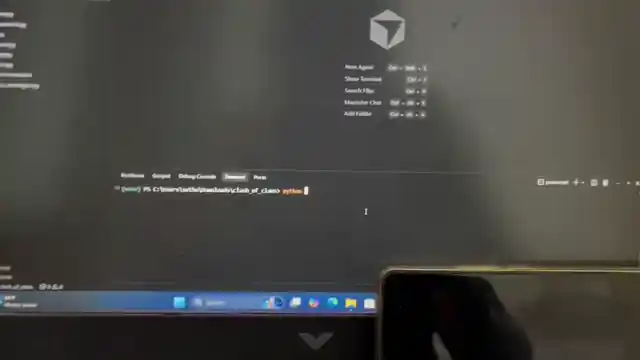

# Clash of Clans — Vision Attack Bot

**Python · OpenCV · ADB · scrcpy**

Analyze the enemy base with computer vision, lock the right drop lines, and deploy attackers automatically.

<p align="center">
  
</p>

<p align="center">
  <em>Inline demo — corners → Attack → Single Player → detect → drop troops</em>
</p>

---

## What it does

| Stage | Action |
|-------|--------|
| **1. Scout** | Swipe all 4 corners of the village |
| **2. Enter** | Tap **Attack** → **Single Player** → **Attack** |
| **3. Analyze** | Detect Town Hall, storages, collectors |
| **4. Attack** | Compute drop lines just outside detections |
| **5. Deploy** | Select troops and tap along those lines |

The bot does **not** guess blindly. It sees the base, finds high-value buildings, then places attackers on legal drop positions near those targets.

---

## Demo

If the animated preview above does not play in your viewer, open:

- [`demo.webp`](demo.webp) — lightweight animated preview  
- [`demo.mp4`](demo.mp4) — full-quality recording  

```bash
# Regenerate WebP from MP4
ffmpeg -y -i demo.mp4 -t 50 -vf "fps=6,scale=640:-1:flags=lanczos" -loop 0 -an -c:v libwebp -quality 35 demo.webp
```

---

## Pipeline

```text
┌─────────────┐     ┌──────────────┐     ┌─────────────────┐
│  Phone      │────▶│  scrcpy +    │────▶│  OpenCV detect  │
│  (CoC)      │ ADB │  capture.py  │     │  Town Hall /    │
│             │◀────│  overlay     │     │  Gold / Elixir  │
└─────────────┘ tap │              │     └────────┬────────┘
                    └──────────────┘              │
                                                  ▼
                                        ┌─────────────────┐
                                        │  Drop-line math │
                                        │  → ADB troop    │
                                        │    taps         │
                                        └─────────────────┘
```

### Detection targets

- **Town Hall** — template + orange-roof geometry (high confidence)
- **Elixir storage / collector** — HSV + building templates
- **Gold storage / mine** — HSV + building templates

Collectors use **building-body templates** (not Full! icons), so they still work when collect bubbles are absent.

---

## Quick start

### Requirements

- Windows
- Python 3.10+
- USB debugging enabled on Android
- [scrcpy](https://github.com/Genymobile/scrcpy) (ADB included)

### Setup

```powershell
cd clash_of_clans
python -m venv venv
.\venv\Scripts\activate
pip install -r requirements.txt
```

Edit `config.py` if needed:

- `SCRCPY_DIR` / `ADB_PATH`
- `DEVICE_SERIAL` (`adb devices`)
- `WINDOW_TITLE` (scrcpy window name)

### Run

```powershell
# Live CV overlay on scrcpy (click to tap, D = detect, A = full attack)
python capture.py

# One-shot detection preview
python detect.py

# Full attack bot
python bot.py
```

---

## Attack flow (`bot.py` / `actions.py`)

1. Swipe map → 4 corners  
2. Tap **Attack!** `(155, 993)`  
3. Tap **Single Player** `(669, 594)`  
4. Tap **Attack!** start `(1196, 842)`  
5. Wait for battle UI  
6. Detect buildings → build outward drop lines  
7. Select troop slots → tap deploy points  

Locked coordinates are for **2392×1080** landscape and scale automatically if size changes.

---

## Project layout

```text
clash_of_clans/
├── bot.py              # Attack entrypoint
├── actions.py          # Swipes, locked UI taps, troop drops
├── detect.py           # CV: Town Hall + resources
├── capture.py          # scrcpy overlay + live CV
├── adb_control.py      # ADB tap / swipe / screencap
├── scrcpy_manager.py   # Launch & grab scrcpy window
├── config.py           # Device / paths
├── templates/          # Building crops (TH, mines, storages…)
├── captures/           # Saved frames & previews
├── demo.mp4            # Full demo video
├── demo.webp           # Inline README demo
└── requirements.txt
```

---

## Overlay controls (`capture.py`)

| Key | Action |
|-----|--------|
| **Click** | ADB tap at that spot |
| **A** | Full attack flow |
| **D** | Run detection + save preview |
| **S** | Save frame |
| **R** | Refresh window / templates |
| **H** | Hide / show drawings |
| **Q** | Quit overlay |

---

## Tuning accuracy

1. On home / battle screen, press **S** in the overlay  
2. Crop buildings into `templates/`  
   - `town_hall.png`, `elixir_storage.png`, `elixir_collector.png`  
   - `gold_storage.png`, `gold_mine.png`  
3. Optional UI crops: `attack_button.png`, `single_player.png`, `attack_start.png`  
4. Press **R** or rerun `detect.py`

For a missed menu button: click it once in the overlay and update `LOCKED_XY` in `actions.py` with the printed `device=(x, y)`.

---

## Disclaimer

This project is for **education / personal experimentation** on devices you own. Automating Clash of Clans can violate Supercell’s Terms of Service and may risk account penalties. Use at your own risk.

---

<p align="center">
  <strong>See the base. Pick the line. Drop the army.</strong>
</p>
